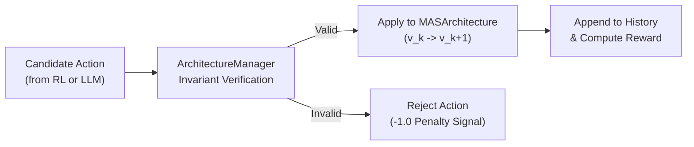

# Architecture Layer (`app/architecture/`)

The **Architecture Layer** formalizes an LLM-based Multi-Agent System (MAS) as a mathematical directed graph and enforces structural integrity, deterministic mutations, and version control across adaptation steps.

---

## 📌 Key Responsibilities

1. **Formal Graph Modeling**: Encapsulates agents, roles, and directed communication channels into structured Pydantic models.
2. **Discrete Mutation Space**: Defines atomic, reversible architectural transformations (`ACTIVATE_AGENT`, `DEACTIVATE_AGENT`, `ADD_EDGE`, `REMOVE_EDGE`, `CHANGE_ROLE`).
3. **Safety & Invariant Guardrails**: Validates that all candidate topologies satisfy reachability, connectivity, and core agent persistence rules before being compiled into execution graphs.
4. **LLM Adaptation Bridging**: Translates natural language adaptation plans from LLMs into strictly typed, guardrailed discrete actions.
5. **State Versioning**: Tracks graph evolution through monotonic version numbers ($v_0, v_1, v_2, \dots$), complete transition histories, and atomic rollbacks.

---

## 📂 Module Components

| Module | Core Classes / Functions | Description |
| :--- | :--- | :--- |
| [`models.py`](models.py) | `AgentDefinition`, `CommunicationEdge`, `MASArchitecture` | Formal Pydantic schemas representing the MAS topology, agent states, and serialization. |
| [`actions.py`](actions.py) | `ActionType`, `ArchitectureAction` | Discrete mathematical mutation definitions and action payload validation. |
| [`manager.py`](manager.py) | `ArchitectureManager` | Guardrail engine verifying structural invariants, connectivity, and core agent protection. |
| [`adaptive.py`](adaptive.py) | `AdaptiveArchitecture` | Version tracker managing atomic state transitions, delta histories, and rollbacks. |
| [`llm_adapter.py`](llm_adapter.py) | `LLMArchitectureAdapter` | Translates high-level LLM task planning into concrete candidate `ArchitectureAction` sets. |

---

## 📐 Formal Architecture Model

An architecture state $G \in \mathcal{G}$ is defined as a 4-tuple:
$$G = \langle \mathcal{V}, \mathcal{E}, \mathcal{R}, \alpha \rangle$$

Where:
- $\mathcal{V} = \{v_1, v_2, \dots, v_N\}$ is the finite universe of agent identifiers (e.g., `planner`, `researcher`, `coder`, `critic`, `tool_executor`, `finalizer`).
- $\mathcal{E} \subseteq \mathcal{V} \times \mathcal{V}$ is the set of directed communication edges $(v_i, v_j)$ allowing output from agent $v_i$ to route into agent $v_j$.
- $\mathcal{R}: \mathcal{V} \to \Sigma_{\text{roles}}$ maps each agent to its specialized functional persona.
- $\alpha: \mathcal{V} \to \{0, 1\}$ is the activity indicator function specifying whether an agent is active in the current compiled subgraph.

---

## 🛡️ Structural Invariants Enforced by `ArchitectureManager`

Before any candidate mutation is accepted, `ArchitectureManager` validates:
1. **Core Agent Preservation**: Critical coordination nodes (such as `planner` and `finalizer`) cannot be deactivated or pruned.
2. **Graph Reachability**: Active non-planner agents must have at least one valid incoming edge and at least one valid outgoing edge leading to `finalizer`.
3. **Loop & Self-Reference Prevention**: Directed self-loops $(v_i, v_i)$ are disallowed.
4. **Dangling Edge Elimination**: Edges referencing inactive agents are automatically pruned or rerouted around the deactivated node.
5. **Edge Redundancy Checking**: Duplicate identical edges are rejected as invalid transitions.

---

## 🔄 Mutation Lifecycle

