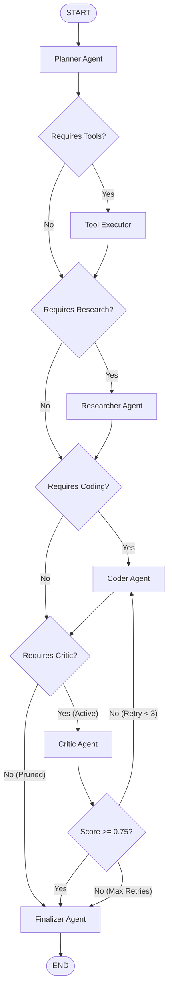

# Dynamic LangGraph Engine (`app/graph/`)

The **Dynamic LangGraph Engine** translates high-level architectural definitions (`MASArchitecture`) into executable, compiled [LangGraph](https://github.com/langchain-ai/langgraph) `StateGraph` instances on the fly.

---

## 📌 Key Architectural Responsibilities

1. **On-The-Fly Compilation**: Ingests mutated architecture graphs and compiles native `StateGraph(ExtendedMASState)` objects containing *only* active agents.
2. **Dynamic Edge Wiring & Automatic Bypasses**: Automatically constructs routing topologies and inserts bypass edges around pruned agents (e.g., routing directly from `Researcher` or `Coder` to `Finalizer` if `Critic` is inactive).
3. **Threshold-Gated Quality Loops**: Enforces iterative feedback cycles between `Critic` and generative agents (`Coder`, `Tool Executor`) bounded by a configurable retry count.
4. **Graph State Persistence**: Carries full execution context (`user_task`, `planner_output`, agent scratchpads, review critique, tool outputs, message history) across node transitions.
5. **Multi-Format Visualizer**: Generates ASCII diagrams, Mermaid flowchart markdown, and Graphviz/Pillow PNG bytes for real-time frontend rendering.

---

## 📂 Module Files

| File | Core Classes / Functions | Description |
| :--- | :--- | :--- |
| [`state.py`](state.py) | `MASState`, `ExtendedMASState` | TypedDict defining global state channels, messages, and node execution outputs. |
| [`dynamic_builder.py`](dynamic_builder.py) | `DynamicGraphBuilder`, `build_dynamic_mas_graph()` | Compiles `MASArchitecture` into executable LangGraph `StateGraph` with automatic bypasses. |
| [`adaptive_integration.py`](adaptive_integration.py) | `AdaptiveWorkflowAdapter` | Validates graph connectivity, LangGraph compatibility, and execution plan sanity. |
| [`workflow.py`](workflow.py) | `create_mas_workflow()` | Static 5-agent baseline pipeline used for comparative benchmarking. |
| [`visualizer.py`](visualizer.py) | `render_langgraph_ascii()`, `render_mermaid_graph()`, `get_graph_png_bytes()` | Visual representation tools supporting terminal display, web UI streaming, and reports. |

---

## 🔄 Dynamic Compilation & Bypass Logic

