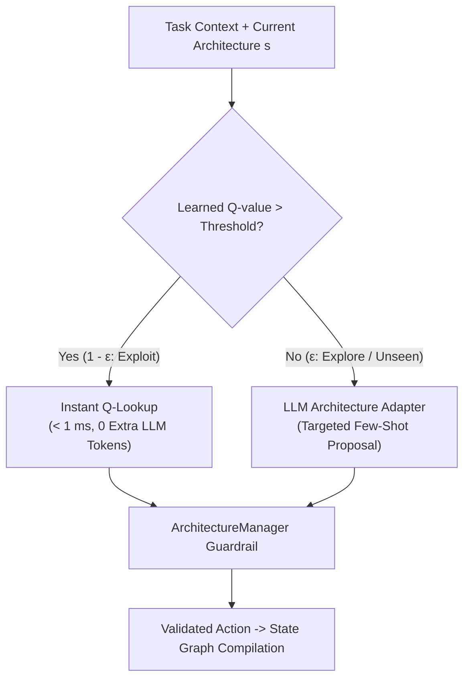

# Reinforcement Learning & Meta-RL Layer (`app/rl/`)

The **RL Layer** formulates Multi-Agent System (MAS) architecture adaptation as a discrete Markov Decision Process (MDP) and meta-learning framework, enabling rapid adaptation across diverse task distributions.

---

## 📌 Theoretical Framework

### 1. Mathematical Formulation
An adaptation episode is formalized as an MDP: $\mathcal{M} = \langle \mathcal{S}, \mathcal{A}, \mathcal{P}, \mathcal{R}, \gamma \rangle$:
- **State Space ($\mathcal{S}$)**: Combines graph topology (activity vector $\mathbf{v}_{\text{active}} \in \{0, 1\}^N$, role assignments $\mathbf{v}_{\text{role}} \in \mathcal{R}^N$, adjacency matrix $\mathbf{A} \in \{0, 1\}^{N \times N}$) and task context vector $\mathbf{c}_\tau$.
- **Action Space ($\mathcal{A}$)**: Bijective discrete integer mapping over atomic graph mutations:
  $$\mathcal{A} = \{\text{ACTIVATE}(i), \text{DEACTIVATE}(i), \text{ADD\_EDGE}(i, j), \text{REMOVE\_EDGE}(i, j), \text{CHANGE\_ROLE}(i, r)\}$$
- **Reward Function ($\mathcal{R}$)**: Decoupled multi-objective reward balancing capability coverage ($C_{\text{cov}}$), structural compactness ($C_{\text{struct}}$), simplification bonuses, and bloat penalties.

---

## 📂 Module Components

| Module | Core Classes | Responsibility |
| :--- | :--- | :--- |
| [`state.py`](state.py) | `ArchitectureStateEncoder` | Deterministic observation encoder converting graph topology into hashable keys and numeric vectors. |
| [`action_space.py`](action_space.py) | `ArchitectureActionMapper` | Bijective bidirectional mapper linking discrete action IDs $[0, |\mathcal{A}| - 1]$ to concrete mutations. |
| [`environment.py`](environment.py) | `MASArchitectureEnv` | Gymnasium-compatible environment simulating architecture transitions and step rewards. |
| [`meta_task.py`](meta_task.py) | `MetaTask`, `MetaTaskContext` | Represents task categories (Greeting, Math, Coding, Research, Synthesis), required capabilities, and difficulty. |
| [`task_distribution.py`](task_distribution.py) | `TaskDistribution` | Manages task families, sampling distributions, and train/test cross-task splits. |
| [`q_learning.py`](q_learning.py) | `QLearningPolicy`, `QTable` | Tabular Q-learning baseline with task-aware state encoding and MongoDB/disk persistence. |
| [`active_selector.py`](active_selector.py) | `RLArchitectureSelector` | $\epsilon$-greedy runtime arbitrator enabling sub-millisecond, zero-LLM adaptations for learned states. |
| [`task_conditioned_policy.py`](task_conditioned_policy.py) | `TaskConditionedArchitecturePolicy` | PyTorch multi-layer perceptron (MLP) mapping concatenated task context and graph state to action logits. |
| [`meta_trainer.py`](meta_trainer.py) | `MetaTrainer` | Multi-task meta-training loops collecting trajectories across task distributions. |
| [`meta_neural_trainer.py`](meta_neural_trainer.py) | `MetaNeuralTrainer` | Trains shared neural policies across task distributions and quantifies fast adaptation gains. |
| [`task_transfer.py`](task_transfer.py) | `TaskTransferEvaluator` | Measures zero-shot and few-shot knowledge transfer to held-out, unseen task domains. |
| [`transfer_evaluation.py`](transfer_evaluation.py) | `TransferEvaluationSuite` | Automated benchmarking suite comparing meta-learned policies vs random and static baselines. |

---

## ⚡ Active RL Architecture Selector (`active_selector.py`)

During live inference, the orchestrator consults `RLArchitectureSelector`:

### Efficiency Gains of Instant Q-Lookup:
- **Adaptation Latency**: $< 1\text{ ms}$ (vs. $1,200\text{ ms} - 2,500\text{ ms}$ when querying LLM adapter).
- **Token Overhead**: **0 tokens** (vs. ~650 tokens per LLM adaptation prompt).
