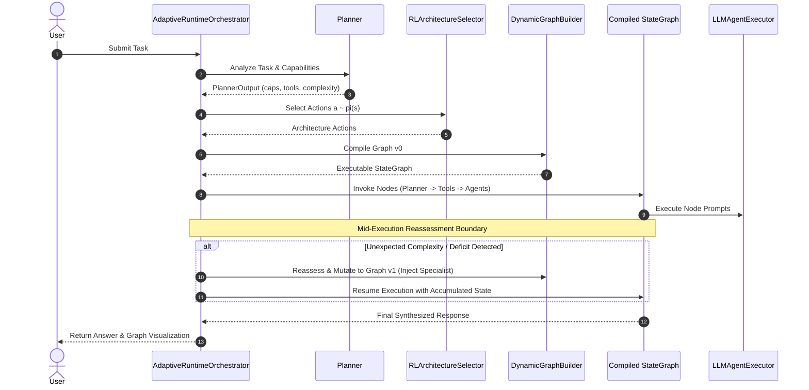

# Runtime Orchestration Layer (`app/runtime/`)

The **Runtime Layer** coordinates end-to-end execution: planning, active RL adaptation, dynamic LangGraph compilation, live LLM invocation, mid-execution self-healing, and session lifecycle management.

---

## 📌 Core Capabilities

1. **Two Execution Modes**:
   - `run()`: Executes standard baseline or static pre-adapted pipelines.
   - `run_dynamic()`: Dynamically builds the LangGraph topology, executes active nodes, and supports **Two-Stage Mid-Execution Reassessment** ($v_0 \to v_1$).
2. **Session Lifecycles (`--continuous` vs `--fresh`)**:
   - Continuous Mode: Preserves and incrementally mutates the architecture across consecutive multi-turn conversational turns.
   - Fresh Mode: Resets the architecture back to baseline ($v_0$) for every new incoming prompt.
3. **Mid-Stream Self-Healing & Dynamic Injection**:
   - Halts execution at predefined boundaries (e.g., post-coding or post-critique).
   - If unexpected complexity or missing tools are detected, mutates $v_0 \to v_1$ and resumes seamlessly with accumulated state.
4. **Live LLM Agent Dispatch**:
   - Connects to NVIDIA NIM endpoints (e.g. `mistralai/mistral-nemotron`, `meta/llama-3.1-70b-instruct`) with streaming telemetry and token tracking.

---

## 📂 Module Files

| File | Core Classes | Description |
| :--- | :--- | :--- |
| [`orchestrator.py`](orchestrator.py) | `AdaptiveRuntimeOrchestrator`, `DynamicGraphExecutionResult` | Central workflow coordinator managing planning, RL selection, dynamic compilation, execution, and state storage. |
| [`llm_execution.py`](llm_execution.py) | `ExistingLLMAgentExecutor`, `LLMExecutionResult` | Dispatches live LLM agent requests to NVIDIA NIM, collects token usage, and manages node callback hooks. |

---

## 🔄 Two-Stage Dynamic Execution Lifecycle

